<p align="center">
  
</p>

<h1 align="center">NetLedger</h1>

<p align="center">
  <b>Every config. Every change. Every device. In Git.</b><br>
  Multi-vendor network configuration backup, change tracking and health monitoring, built on NAPALM.
</p>

<p align="center">
  <a href="https://github.com/SalamoneJack/NetLedger/actions/workflows/ci.yml"></a>
  <a href="https://pypi.org/project/netledger/"></a>
  
  
  
  <a href="LICENSE"></a>
</p>

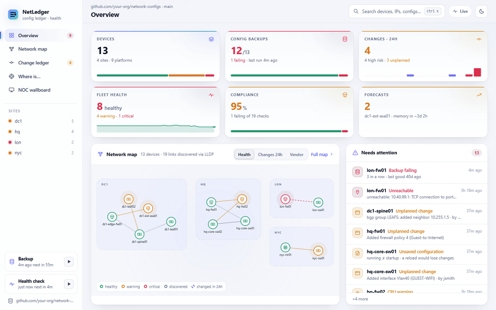

NetLedger logs in to your routers, switches and firewalls, pulls their configurations with
[NAPALM](https://github.com/napalm-automation/napalm), strips out the noise and **commits every real change
straight to a Git repository you point it at**. Then it tells you what each change actually *did*: which
sections it touched, how risky it is, who made it and whether it happened inside your change window. The
same sessions watch **CPU, memory, temperatures, fans and power supplies**, keep a history, and warn you
*days before* a memory leak takes a box down.

It runs wherever you want it: **Kubernetes** (Helm or Kustomize), **Docker**, a **Linux** server
(systemd) or a **Windows** server, from the same codebase. The web console is built in: no database,
no Node.js, no CDN. It works on an air-gapped management network.

## Flagship features

### 🧠 Change intelligence

Every change is parsed into the configuration sections it touched, whatever the vendor syntax: IOS-style
indentation, FortiOS `config`/`edit` blocks, Junos braces, PAN-OS `set` commands and RouterOS exports.
Each section is classified (Routing, Firewall & ACLs, Access & AAA, VPN, NAT, Interfaces, VLANs, ...),
scored 0-100 and **summarized in plain English**. The summary appears in the console, in the commit
message and in your Slack or Teams alert. Shutting an interface, touching BGP or adding an ACL is high
risk; editing a description is low.

**Change windows** (`changes.windows: ["sat 22:00-sun 04:00"]`) turn every change made outside them into an
**unplanned change**: flagged in the ledger, noted in the commit, and alerted with `warning` severity.

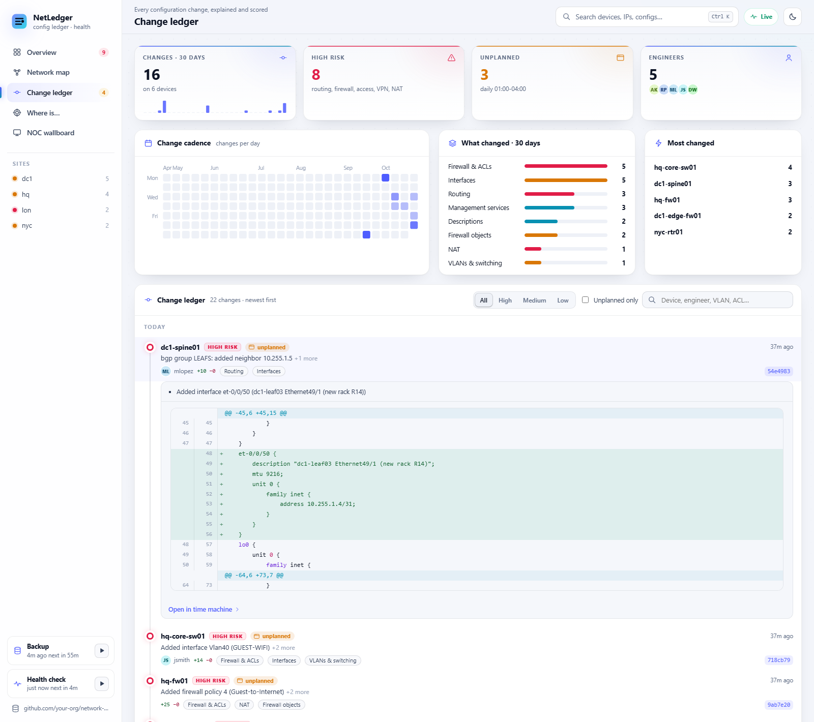

```text
hq-core-sw01: running config changed (+14/-0)
...
Changed by: jsmith at 14:02:11 UTC Fri Oct 30 2026
Window:     outside the approved change windows
Risk:       high (Firewall & ACLs, Interfaces, VLANs & switching)
Summary:
  - Added interface Vlan40 (GUEST-WIFI)
  - Added ACL GUEST-ISOLATION
  - Added VLAN 40 (GUEST-WIFI)
```

### 🕰️ Configuration time machine

Every version of every device, on a timeline coloured by risk. Click any version to see what changed and
why it matters. Shift-click to compare any two versions, unified or side by side, with changed words
highlighted. Or read the full configuration as it was on that day, with syntax highlighting, collapsible
sections and find-in-config, and download it to restore. Secrets are always masked. The equipment
faceplate lights the ports that have LLDP neighbours, and its status LEDs mirror the last health check.

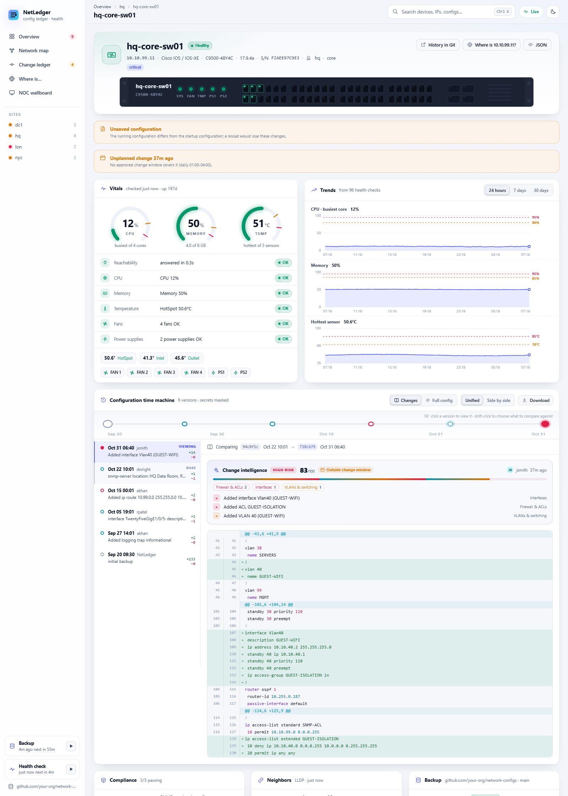

### 🎯 Where is…? IP-aware search across the whole network

Type an IP address and NetLedger tells you **where it lives**: the interface subnet that contains it on
every device (longest prefix first, like a routing table), plus every route, firewall object and ACL that
covers it. It understands every vendor's notation: `10.1.1.1 255.255.255.0`, ACL wildcards
(`0.0.0.255`), `/24`, `host 10.1.1.1`, `address=10.1.1.1/24`, IPv6. Plain text and `/regular expressions/`
work too, from the console, the API or the command line.

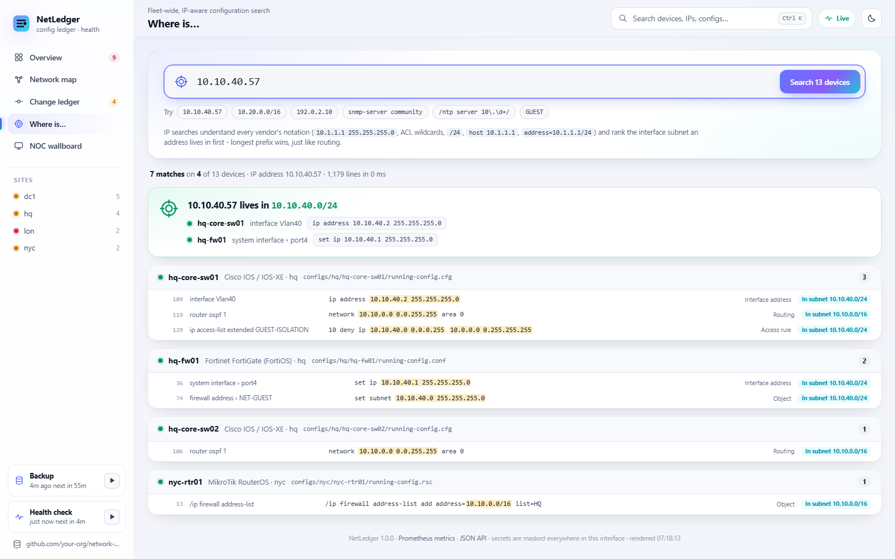

### 📈 Trends and capacity forecasts

Every health check is kept in a small SQLite history (30 days by default). Device pages chart CPU, memory
and temperature over 24 hours, 7 days or 30 days against your thresholds. Every table row gets sparklines
and a 24-hour status strip. NetLedger fits a trend to the last week and **predicts when a leak or a rising
temperature will cross a threshold**: "memory reaches 95 % in ~3 days". It raises a `capacity_forecast`
alert and exports `netledger_forecast_seconds_to_threshold` for Prometheus.

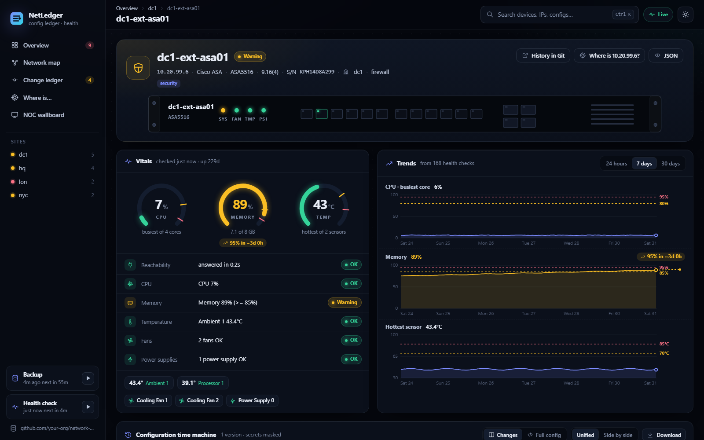

### 🗺️ Live network map

The topology is discovered from LLDP during health checks; a link only needs to be seen from one side.
Health is drawn live. Switch the overlay to *Changes 24h* to see where changes happened, and to how
risky they were, or to *Vendor*. Drag nodes, zoom and pan; positions are remembered.

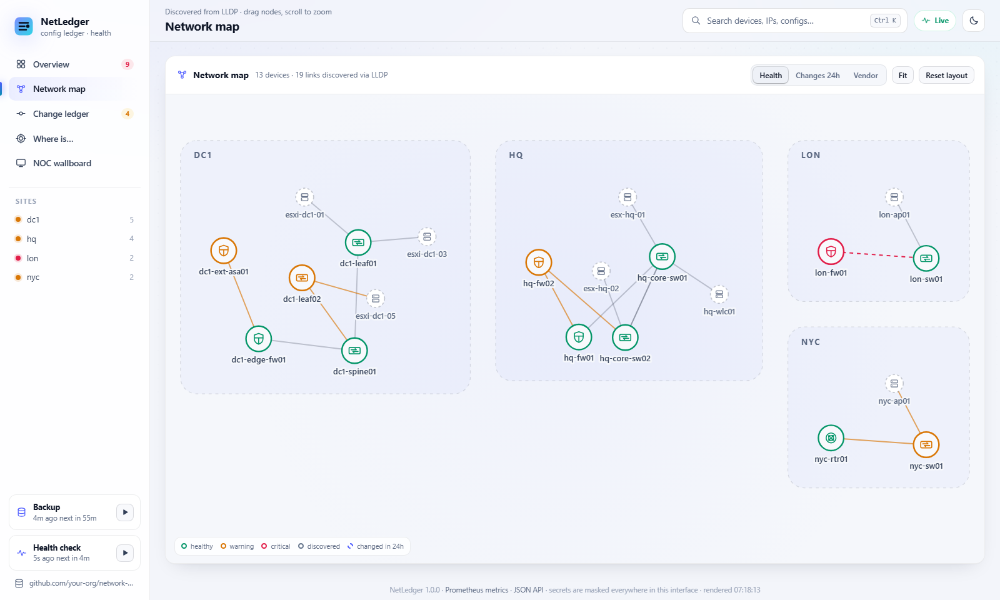

### ⚡ And everywhere

- **Live console.** Pages update in place while backups and health checks run, with progress in the sidebar
  and toasts for new events. No refresh button.
- **Command palette** (`Ctrl K`). Jump to any device, page or action, or type an IP to find it. Keyboard
  shortcuts: `/` filters, `g o` / `g m` / `g c` / `g s` / `g w` navigate.
- **NOC wallboard** at `/wall`: big status tiles, a clock and a ticker of the latest changes, for the TV in
  the operations room.
- **Day and night themes.** Light by default, one click to dark (remembered per browser; `server.theme`
  sets the default).

<details>
<summary><b>More screenshots:</b> the full overview, dark theme and the NOC wallboard</summary>

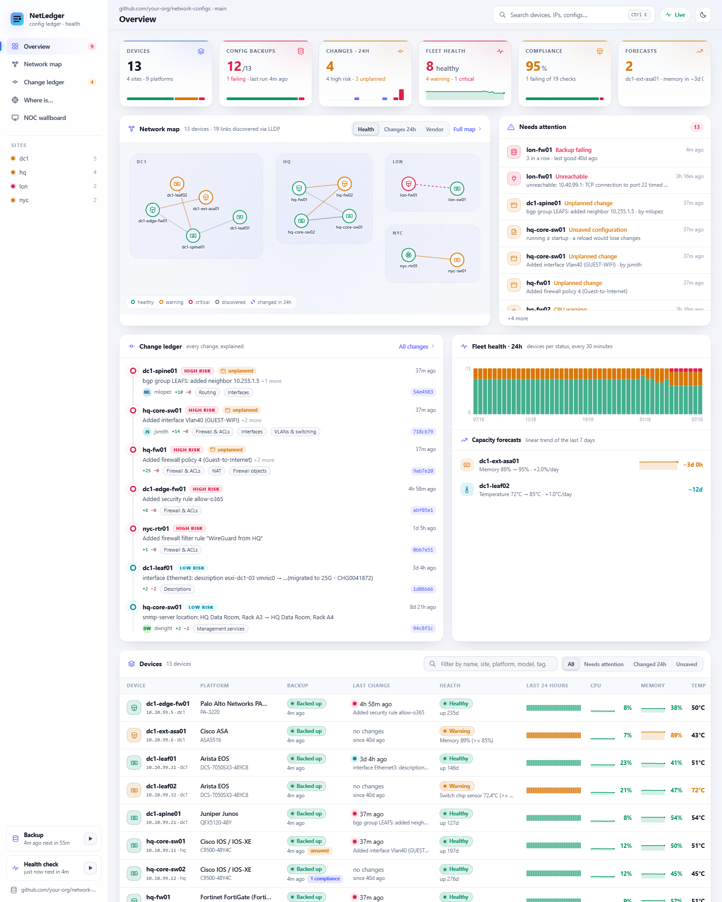

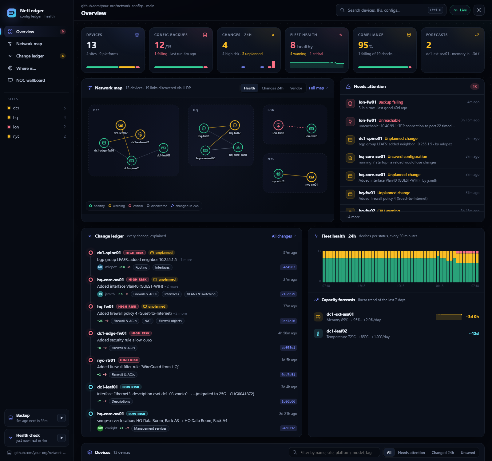

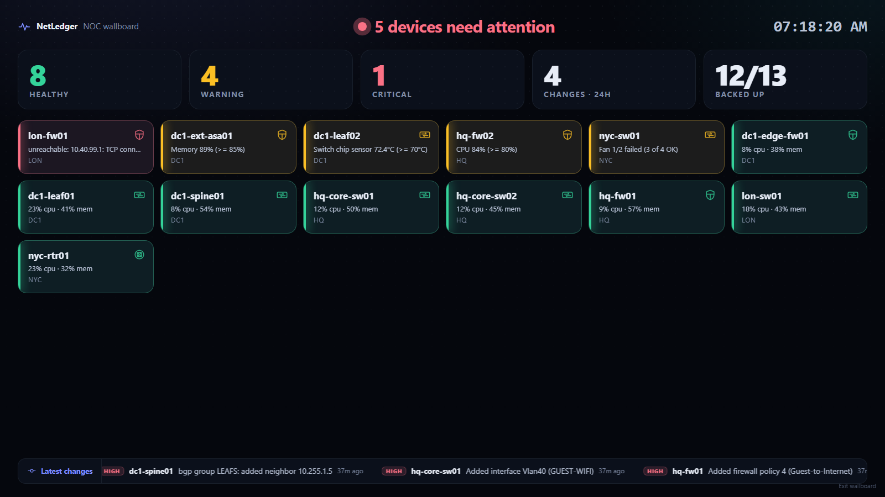

</details>

## Highlights

- **Configs to Git, automatically.** GitHub, GitLab, Gitea, Bitbucket or Azure DevOps over HTTPS
  tokens or SSH keys, or straight through the GitHub API with no `git` binary at all. GitHub App
  authentication included.
- **24 platforms out of the box.** Cisco IOS/IOS-XE, NX-OS, IOS-XR, ASA and WLC; Fortinet FortiGate;
  Juniper; Arista; Palo Alto; Huawei; HPE/Aruba (Comware, ProCurve, AOS-CX); MikroTik; Dell OS10;
  Extreme; VyOS; Ubiquiti; Ruckus; Check Point. Any other NAPALM driver works too, and any of
  Netmiko's 200+ device types can be backed up with the `generic` platform.
- **No noise commits.** Timestamps, byte counters, `ntp clock-period` and FortiGate's re-encrypted
  `ENC` secrets are normalized per platform, so Git history only shows real changes.
- **Health monitoring.** CPU, memory, temperature, fans, PSUs, reachability and reboot detection,
  with thresholds, per-device overrides and alerts only on state changes (no alert storms).
- **Guardrails.** Golden-config compliance rules on every backup, unsaved-change detection (running ≠
  startup), and a shrink guard that refuses to commit a truncated config.
- **Secrets under control.** Keep them, mask them, or replace them with a stable keyed hash so you
  still see *that* a password changed without exposing it. The console, its API and alerts always mask.
- **Inventory from anywhere.** YAML with group inheritance, CSV exports, NetBox, or an existing Oxidized.
- **Try it in seconds.** `netledger demo` builds a simulated 13-device network with six weeks of history
  (changes by five engineers, a memory leak, a failing fan, a site outage) so you can explore everything
  without touching production.

## How NetLedger compares

[Oxidized](https://github.com/ytti/oxidized) and [RANCID](https://shrubbery.net/rancid/) are mature,
battle-tested backup tools with broader device coverage. If configuration backup is all you need, they are
great choices. NetLedger is for teams that also want to *understand* every change and keep an eye on device
health, in one tool. It can also sit on top of Oxidized: Oxidized keeps collecting, and NetLedger adds the
analysis, alerts and console.

| | NetLedger | Oxidized | RANCID |
|---|---|---|---|
| Configuration backup with Git history | ✅ | ✅ | ✅ (also CVS / Subversion) |
| Device coverage | 24 built-in platforms, any NAPALM driver, plus a Netmiko-based `generic` | 130+ OS types | dozens of device types |
| Written in | Python (NAPALM, Netmiko) | Ruby | Perl and expect |
| Plain-English change summaries and risk scores | ✅ | - | - |
| Change windows and unplanned-change alerts | ✅ | - | - |
| IP-aware "where is" search (subnets, wildcards, every notation) | ✅ | - | - |
| CPU, memory, temperature, fan and PSU health checks | ✅ | - | - |
| Health history and exhaustion forecasts | ✅ | - | - |
| LLDP network map | ✅ | - | - |
| Web interface | ✅ built in | ✅ (oxidized-web) | - |
| Works on top of an existing Oxidized (its git repository or API) | ✅ | n/a | - |

### Already using Oxidized?

Keep it. Point NetLedger at Oxidized's git repository or its API, and every configuration Oxidized
collects gets NetLedger's change intelligence, change windows, compliance rules, alerts and console. NetLedger
does not log in to those devices and never writes to Oxidized's repository. An Oxidized exec hook can make
it process a change the moment Oxidized stores it. LibreNMS users can point it at the same Oxidized.

```yaml
inventory:
  - type: oxidized
    path: /var/lib/oxidized/configs.git    # or mode: api + url: http://oxidized:8888
```

See [docs/oxidized.md](docs/oxidized.md).

## From the command line

**Backups.** Only real changes are committed, each with who made it and what it means:

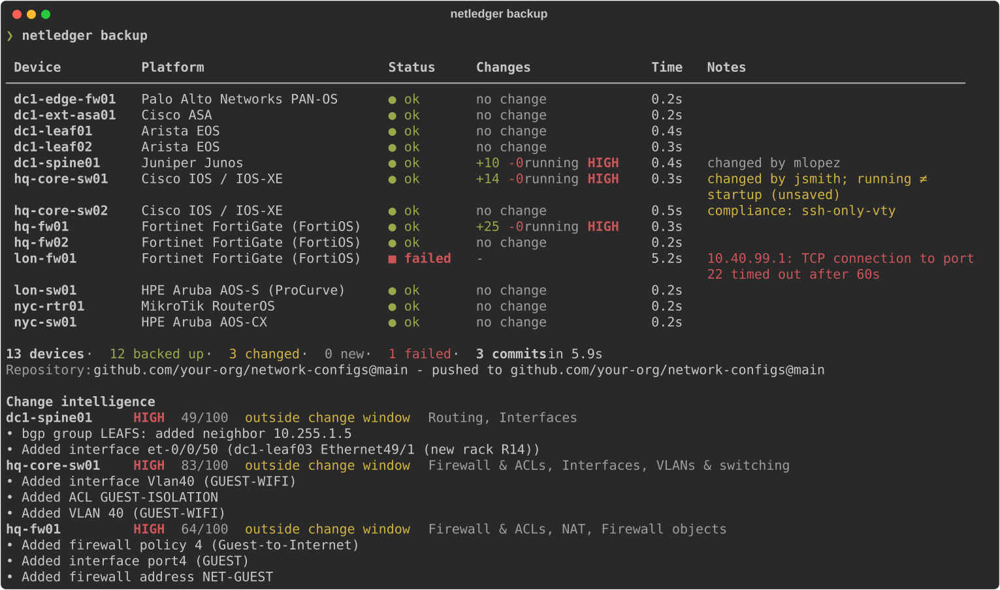

**Where is an address?** The same IP-aware search, in your terminal:

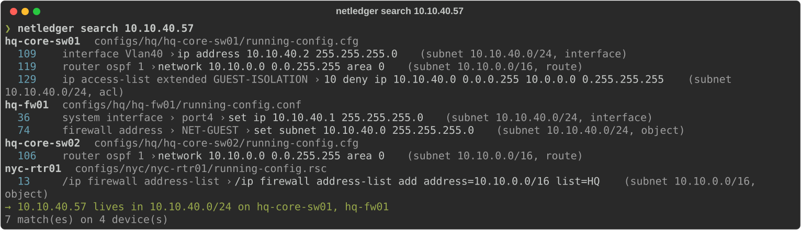

**Health checks** for the whole estate, with Nagios-compatible exit codes for existing monitoring:

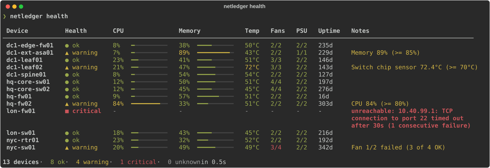

<details>
<summary><b>More:</b> dry-run diffs, commit history and platforms</summary>

**Preview what changed** before committing anything (secrets masked):

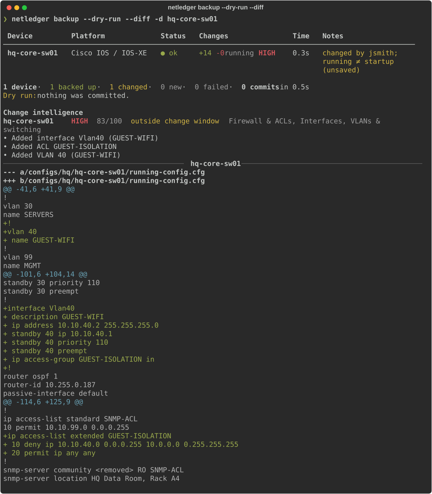

**What lands in Git:** structured, searchable commit messages.

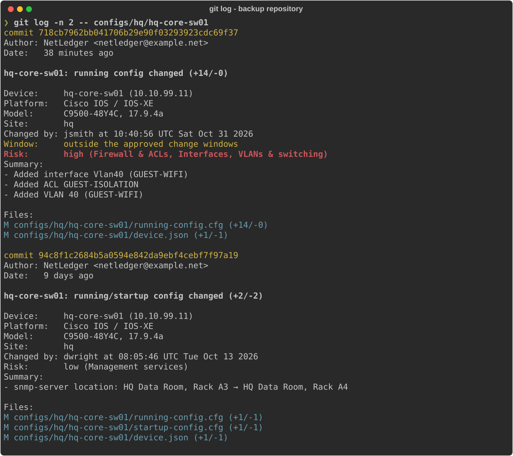

**Supported platforms:**

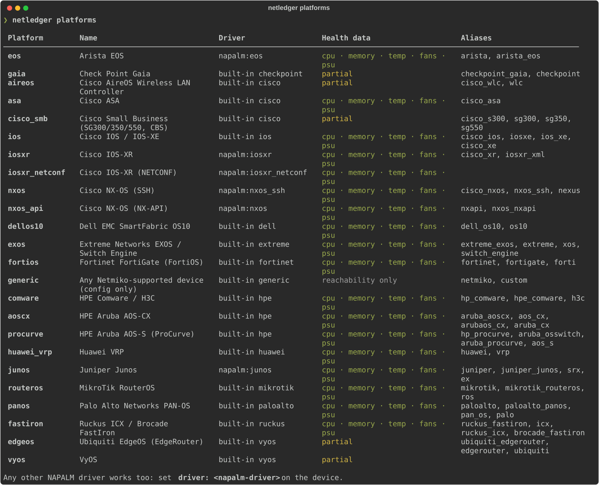

</details>

> All screenshots come from `netledger demo`: simulated devices with made-up names and addresses.
> Regenerate them with `python scripts/screenshots.py` and the tour with `python scripts/demo_gif.py`.

## Quick start

### 1. Take the tour (no network gear needed)

```bash
pip install netledger
netledger demo                      # then open http://127.0.0.1:8080
```

or, with nothing but Docker:

```bash
docker run --rm -p 8080:8080 ghcr.io/salamonejack/netledger demo --host 0.0.0.0
```

### 2. Back up your own network

```bash
netledger init                      # writes netledger.yaml, inventory.yaml and netledger.env
# 1) put credentials and a Git token in netledger.env
# 2) point git.url at an (empty or existing) repository
# 3) list your devices in inventory.yaml
netledger validate                  # checks config, inventory, credentials and drivers
netledger test -d core-sw01         # log in to one device and show its facts
netledger backup --dry-run --diff   # see what would be committed
netledger backup                    # commit and push
netledger serve                     # run on a schedule with the web console on :8080
```

A minimal `netledger.yaml`:

```yaml
inventory: [inventory.yaml]

credentials:
  default:
    username: ${NETLEDGER_USERNAME}
    password: ${NETLEDGER_PASSWORD}

git:
  url: https://github.com/your-org/network-configs.git
  token: ${GIT_TOKEN}            # fine-grained token with "Contents: read & write"

schedule:
  backup: "0 * * * *"            # hourly
  health: "*/5 * * * *"          # every five minutes

notifications:
  - type: slack
    url: ${SLACK_WEBHOOK_URL}
```

And `inventory.yaml`:

```yaml
groups:
  core: {platform: ios, role: core}
devices:
  - {name: core-sw01, host: 10.0.0.11, site: hq, groups: [core]}
  - {name: fw01, host: 10.0.0.1, site: hq, platform: fortios}
  - {name: dc1-spine01, host: 10.20.0.21, site: dc1, platform: junos}
```

## Deploy

| Where | How | Guide |
|---|---|---|
| **Kubernetes** | `helm install netledger deploy/helm/netledger -n netledger --create-namespace -f values.yaml` or `kubectl apply -k deploy/kubernetes` | [docs/deployment.md#kubernetes](docs/deployment.md#kubernetes) |
| **Docker** | `docker compose up -d` | [docs/deployment.md#docker](docs/deployment.md#docker) |
| **Linux server** | `sudo deploy/linux/install.sh` (systemd service, hardened) | [docs/deployment.md#linux](docs/deployment.md#linux) |
| **Windows server** | `deploy\windows\install.ps1` (auto-restarting background task) | [docs/deployment.md#windows](docs/deployment.md#windows) |
| **Cron / CI** | `netledger run` (backup + health, exit codes for scripting) | [docs/deployment.md#one-shot](docs/deployment.md#one-shot) |

The container image runs as non-root on a read-only root filesystem. The Kubernetes manifests use the
`restricted` Pod Security Standard, a persistent volume for state, and probes on `/healthz` and `/readyz`.

## How it works

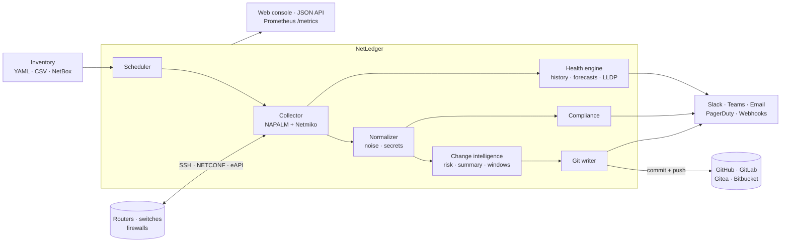

1. **Collect.** Devices are processed in parallel (configurable workers). Each session tries your
   credential sets in order (for example TACACS+ first, then a local fallback account), retries
   transient failures, and is locked so backup and health jobs never log in to the same box at once.
2. **Normalize and understand.** Per-platform rules remove volatile lines and re-encrypted values,
   then secrets are kept, masked or hashed as configured. Change intelligence works out which
   sections changed, how risky that is, and whether a change window covered it.
3. **Commit.** Changed files are committed per device (or in one commit per run) with a structured
   message, and the repository index is refreshed. If someone else pushed in the meantime, NetLedger
   replays its commits on top instead of failing.
4. **Check.** Compliance rules run against the configuration, and health checks grade CPU, memory,
   temperatures, fans and power supplies against your thresholds, record a history, forecast
   exhaustion and collect LLDP neighbours for the network map.
5. **Tell.** Events go to your notifiers only when something changes: a config change (with its
   summary and risk), an unplanned change, a backup that starts failing, a device going critical,
   recovering or rebooting, or a resource predicted to run out.

## What lands in your repository

```text
network-configs/
├── README.md                          ← generated index: model, OS version, serial, last change
└── configs/
    ├── dc1/
    │   ├── dc1-spine01/
    │   │   ├── device.json            ← facts and last change, for tooling
    │   │   └── running-config.conf
    │   └── dc1-edge-fw01/ …
    └── hq/
        ├── hq-core-sw01/
        │   ├── commands/show-inventory.txt   ← optional extra show commands
        │   ├── device.json
        │   ├── running-config.cfg
        │   └── startup-config.cfg
        └── hq-fw01/
            ├── device.json
            └── running-config.conf
```

The folder layout is a template (`git.path: "{site}/{name}"`, also `{role}`, `{vendor}`,
`{platform}`, `{group}`), so the repository can mirror how your team thinks about the network.
Every commit looks like this:

```text
hq-core-sw01: running config changed (+14/-0)

Device:     hq-core-sw01 (10.10.99.11)
Platform:   Cisco IOS / IOS-XE
Model:      C9500-48Y4C, 17.9.4a
Site:       hq
Changed by: jsmith at 14:02:11 UTC Fri Oct 30 2026
Window:     outside the approved change windows
Risk:       high (Firewall & ACLs, Interfaces, VLANs & switching)
Summary:
  - Added interface Vlan40 (GUEST-WIFI)
  - Added ACL GUEST-ISOLATION
  - Added VLAN 40 (GUEST-WIFI)

Files:
  M configs/hq/hq-core-sw01/running-config.cfg (+14/-0)
  M configs/hq/hq-core-sw01/device.json (+1/-1)
```

`git log -- configs/hq/hq-core-sw01`, `git blame` and pull-request style reviews now work on your
network.

## Supported platforms

| Platform | Name | Driver | Startup config | Health data |
|---|---|---|---|---|
| `ios` | Cisco IOS / IOS-XE | NAPALM `ios` (extended) | yes | CPU, memory, temperature, fans, PSUs |
| `nxos` / `nxos_api` | Cisco NX-OS (SSH / NX-API) | NAPALM `nxos_ssh` / `nxos` | yes | CPU, memory, temperature, fans, PSUs |
| `iosxr` / `iosxr_netconf` | Cisco IOS-XR | NAPALM `iosxr` / `iosxr_netconf` | - | CPU, memory, temperature, fans, PSUs |
| `asa` | Cisco ASA | built-in | yes | CPU, memory, temperature, fans, PSUs |
| `aireos` | Cisco AireOS WLC | built-in | - | CPU, memory, temperature |
| `cisco_smb` | Cisco Small Business (SG/CBS) | built-in | yes | CPU, temperature |
| `eos` | Arista EOS | NAPALM `eos` | yes | CPU, memory, temperature, fans, PSUs |
| `junos` | Juniper Junos | NAPALM `junos` | - | CPU, memory, temperature, fans, PSUs |
| `fortios` | Fortinet FortiGate (FortiOS) | built-in, multi-VDOM aware | - | CPU, memory, temperature, fans, PSUs |
| `panos` | Palo Alto Networks PAN-OS | built-in | - | CPU, memory, temperature, fans, PSUs |
| `huawei_vrp` | Huawei VRP | built-in | yes | CPU, memory, temperature, fans, PSUs |
| `comware` | HPE Comware / H3C | built-in | yes | CPU, memory, temperature, fans, PSUs |
| `procurve` | HPE Aruba AOS-S (ProCurve) | built-in | yes | CPU, memory, temperature, fans, PSUs |
| `aoscx` | HPE Aruba AOS-CX | built-in | yes | CPU, memory, temperature, fans, PSUs |
| `routeros` | MikroTik RouterOS 6/7 | built-in | - | CPU, memory, temperature, fans, PSUs |
| `dellos10` | Dell EMC OS10 | built-in | yes | CPU, memory, temperature, fans, PSUs |
| `exos` | Extreme EXOS / Switch Engine | built-in | - | CPU, memory, temperature, fans, PSUs |
| `fastiron` | Ruckus ICX / Brocade FastIron | built-in | yes | CPU, memory, temperature, fans, PSUs |
| `vyos` / `edgeos` | VyOS / Ubiquiti EdgeOS | built-in | - | CPU, memory, temperature |
| `gaia` | Check Point Gaia | built-in | - | temperature, fans, PSUs |
| `generic` | anything Netmiko supports | built-in | optional | reachability |
| *any* | any NAPALM driver (`driver: <name>`) | NAPALM | driver-dependent | driver-dependent |

Aliases such as `cisco_ios`, `fortigate`, `paloalto`, `mikrotik`, `arista` and `juniper` work too
(`netledger platforms` lists them all). Built-in drivers are full NAPALM drivers implemented on
Netmiko, so they also work in your own NAPALM scripts. Details, commands used and per-vendor
notes: [docs/platforms.md](docs/platforms.md).

## Health checks

| Check | Source | Default thresholds |
|---|---|---|
| CPU | busiest core from `get_environment()` | warning 80 %, critical 95 % |
| Memory | used / total | warning 85 %, critical 95 % |
| Temperature | every sensor; device alarm flags and/or your thresholds | device flags |
| Fans / power supplies | failed units | warning (configurable) |
| Reachability | login on every check; critical after N consecutive failures | 2 failures |
| Reboots | uptime shorter than the time since the last check | event |
| Trends | every check stored in `history.db` (SQLite) | 30 days |
| Forecasts | linear trend of memory and temperature over 7 days | alert when < 7 days away |
| Neighbours | LLDP, for the network map | every check |

Thresholds can be overridden per device or group, and noisy sensors (an intentionally empty PSU
slot, for example) can be ignored by regex. `netledger health` exits 0/1/2/3 like a Nagios plugin.
See [docs/health-checks.md](docs/health-checks.md).

## Notifications

Slack, Microsoft Teams (Workflows / Adaptive Cards), Discord, email (SMTP/STARTTLS), PagerDuty
(auto-resolving incidents) and generic webhooks (HMAC-signed). Filter by event type and severity per
notifier. Bursts are folded into a digest. See [docs/notifications.md](docs/notifications.md).

Events: `config_changed`, `backup_failed`, `backup_recovered`, `health_warning`, `health_critical`,
`health_recovered`, `device_rebooted`, `compliance_failed`, `compliance_passed`, `capacity_forecast`.
Configuration changes arrive with their risk and plain-English summary. Unplanned changes (outside
`changes.windows`) are raised to `warning`, so a notifier with `min_severity: warning` only hears
about those.

## Command line

| Command | What it does |
|---|---|
| `netledger init` | Write starter `netledger.yaml`, `inventory.yaml` and `netledger.env` |
| `netledger validate` | Check configuration, inventory, credentials, drivers and schedules |
| `netledger inventory` | List devices (`--format table\|json\|yaml`) |
| `netledger platforms` | List supported platforms and aliases |
| `netledger test -d NAME` | Log in, show facts (`--show-config`, `--health`) |
| `netledger backup` | Back up, commit and push (`--dry-run`, `--diff`, `--no-push`, `--json`) |
| `netledger health` | Check device health (`--json`; exit 0/1/2/3) |
| `netledger run` | Backup, then health |
| `netledger serve` | Scheduler + web console + API + `/metrics` |
| `netledger search PATTERN` | Search every backed-up configuration: a regex, or an IP / subnet for "where is" (`--ip`, `-i`, `-l`) |
| `netledger notify-test` | Send a test message to every notifier |
| `netledger demo` | Simulated network, local repository and dashboard |

Filters work on every device command and combine freely: `-d 'core-*' -s hq -g firewalls -t critical -p fortios`.

## Documentation

- [Web console](docs/console.md): change intelligence, time machine, where-is, forecasts, network map
- [Configuration reference](docs/configuration.md): every setting, with defaults
- [Inventory](docs/inventory.md): YAML groups, CSV, NetBox, credentials and fallbacks
- [Already using Oxidized?](docs/oxidized.md): NetLedger on top of Oxidized's repository or API (LibreNMS too)
- [Platforms](docs/platforms.md): per-vendor details and the commands NetLedger runs
- [Health checks](docs/health-checks.md) and [Prometheus metrics](docs/health-checks.md#prometheus-metrics)
- [Notifications](docs/notifications.md)
- [Deployment](docs/deployment.md): Kubernetes, Docker, Linux, Windows
- [Troubleshooting](docs/troubleshooting.md)
- [Writing a driver](docs/writing-drivers.md)

## Security

Credentials never touch logs, state or the backup repository. Git tokens are passed through the
environment rather than the command line, and errors are redacted. The console never shows a secret
(configurations, diffs and search results are masked even when the repository keeps them), runs no inline
script under a strict Content Security Policy, and escapes everything a device can influence. Device configurations do contain secrets, so keep the
backup repository private or enable masking. More in [SECURITY.md](SECURITY.md).

## Contributing

Issues and pull requests are welcome, and sanitized command output from real devices is the most
valuable contribution for improving parsers. See [CONTRIBUTING.md](CONTRIBUTING.md).

## License

[MIT](LICENSE) © 2026 Jack Salamone
